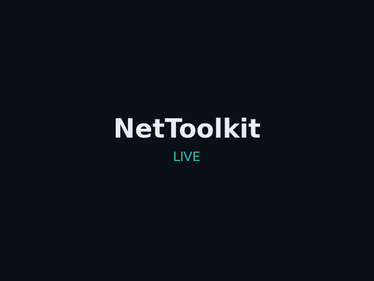
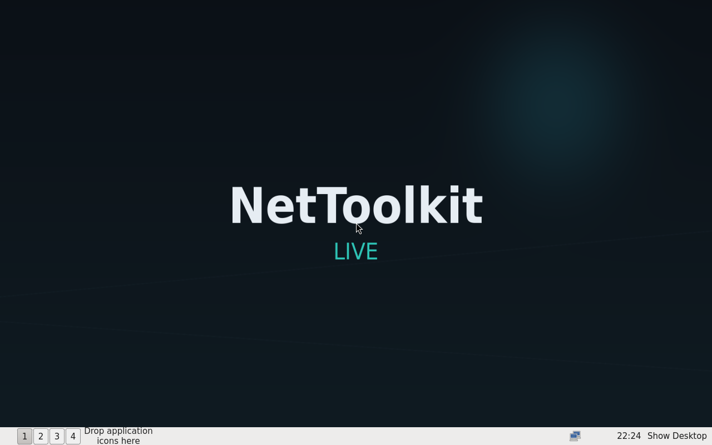
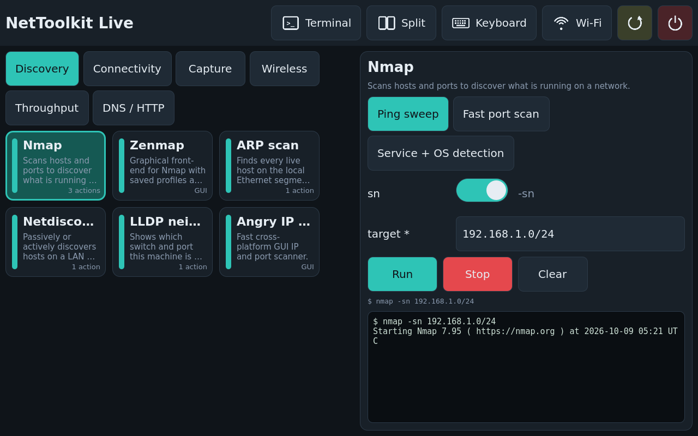
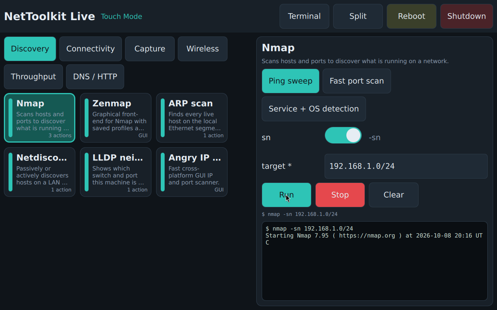
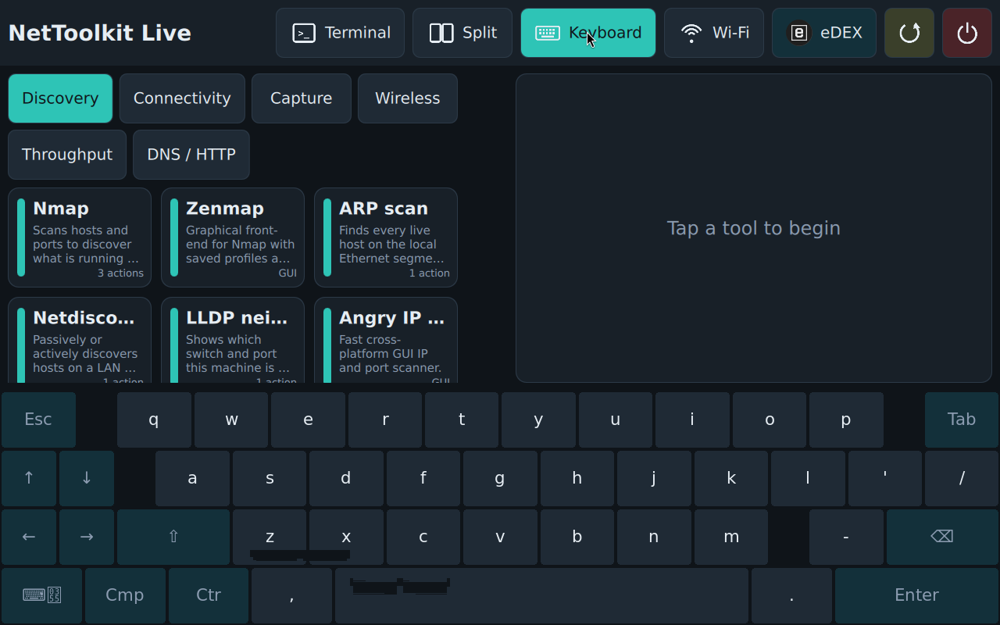
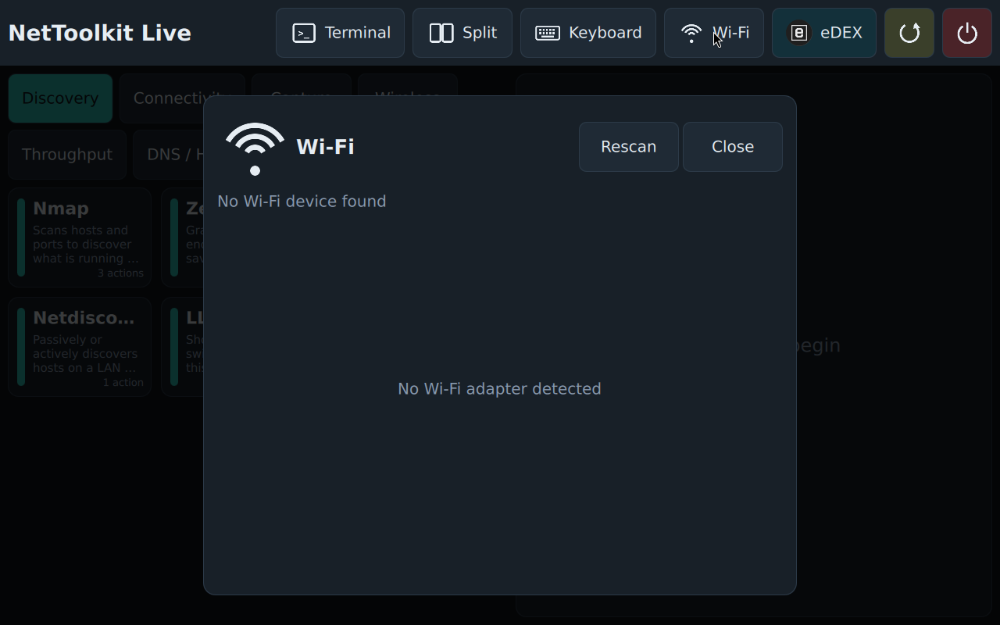
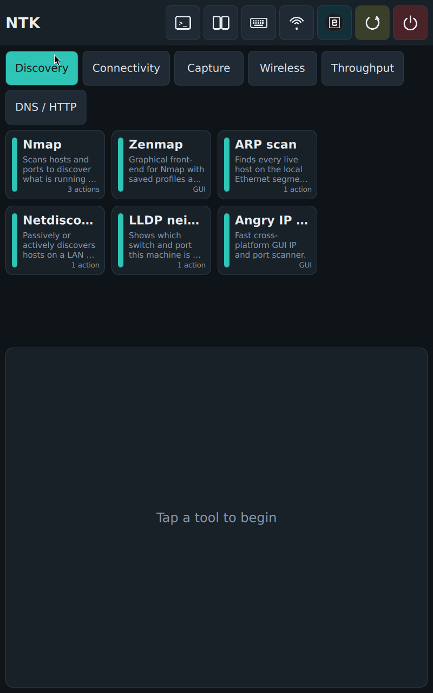
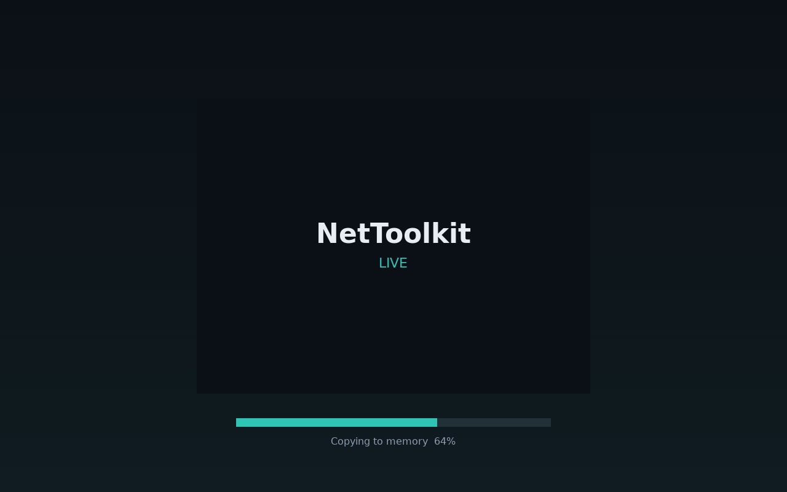
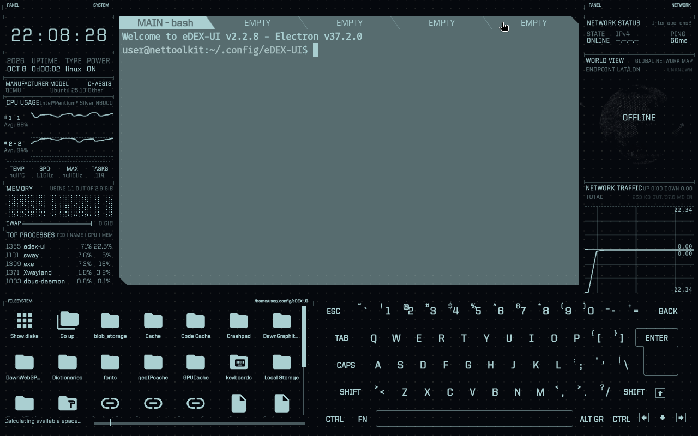

# Backpack Live

[](../../actions/workflows/ci.yml)

A bootable Debian 13 ("trixie") live USB for network discovery and testing — think
"Hiren's BootCD, but Linux with network tools." x86_64, BIOS and UEFI.

Three ways to use it, chosen from the boot menu:

- **Desktop (LXQt)** — a full graphical desktop with NetworkManager and the tools installed.
- **Terminal** — boots to a multi-user console, no X.
- **Touch Mode** — a full-screen, touch-friendly tile launcher (PySide6/QML under sway) that
  builds a form for each tool and streams its output. Top bar: full-screen terminal, split view
  (one terminal beside the launcher, or below it in portrait; the button becomes "Exit split"),
  a phone-style on-screen keyboard, a Wi-Fi scan/connect overlay, and an optional
  [eDEX-UI](https://github.com/GitSquared/edex-ui) sci-fi terminal. When the launcher is narrow
  (split view or portrait) the top bar collapses to icons.

Each entry also has a **copy to RAM** (`toram`) variant that runs entirely from memory so the
USB stick can be removed after boot; the boot splash shows a progress bar while it copies.

## Screenshots

| Boot splash | LXQt desktop |
|---|---|
|  |  |

| Touch Mode | Touch Mode — tool running |
|---|---|
|  |  |

| On-screen keyboard | Wi-Fi overlay |
|---|---|
|  |  |

| Portrait | Copy-to-RAM progress |
|---|---|
|  |  |

| eDEX-UI | |
|---|---|
|  | |

## Tools

Discovery, connectivity, capture, wireless, throughput, and DNS/HTTP tools — nmap, arp-scan,
netdiscover, tcpdump, tshark/wireshark, iperf3, mtr, hping3, kismet, aircrack-ng, Angry IP
Scanner, and more. The full list with per-tool commands lives in
[`manifest/tools.yaml`](manifest/tools.yaml) and is installed on the image at
`/etc/backpack/tools.yaml`.

Default login: user **`user`**, password **`live`**, passwordless `sudo`.

## Build

The build runs `live-build` inside a privileged `debian:trixie` Docker container (the default),
so it works on any host with Docker. QEMU and OVMF are used from the host for testing.

```bash
make build          # -> build/backpack.iso   (full log: build/logs/build.log)
make test-bios      # boot the ISO in QEMU (BIOS) and wait for the in-guest self-test
make test-uefi      # same, UEFI (OVMF)
make test-persist   # persistence matrix (BIOS/UEFI x normal/toram)
make release        # staged ISO + SHA256SUMS in build/release/
```

Build on a native Debian/Ubuntu host without Docker by passing `USE_DOCKER=0` (needs
`live-build` >= 2023 and root). On Ubuntu this will not work — its `live-build` is a dead fork.

First build pulls ~1 GB of packages and takes roughly 8-12 minutes; later builds reuse the
package cache.

### eDEX-UI (optional)

The Touch Mode "eDEX" button needs the `edex-ui` Debian package, built from the vendored and
modernized fork in `touchmode/edex/` (Electron 37). It is not built by `make build`; build it
once and it is picked up by the next `make build`:

```bash
docker build -t backpack-edex -f tools/docker/Dockerfile.edex tools/docker
scripts/build-edex-deb.sh        # -> live/config/packages.chroot/edex-ui_*.deb
```

Without it the image still builds; the eDEX button simply does not appear.

## Write to a USB stick

```bash
make mkusb DEV=/dev/sdX            # writes the ISO + a 5 GB persistence partition
make mkusb DEV=/dev/sdX SIZE=10G   # larger persistence
make mkusb DEV=/dev/sdX KEEP=1     # update the system only, keep the existing persistence
make mkusb-gui                     # same thing in a small GTK4 window (password via pkexec)
scripts/mkusb.sh --dry-run /dev/sdX   # print every command without touching the disk
```

`mkusb.sh` refuses disks larger than 256 GB without `--force`, refuses the running system disk,
and asks you to type the device name to confirm. **It erases the target disk.**

### USB writer without a checkout (`backpack-mkusb` package)

The writer and its GUI are also packaged for Debian/Ubuntu desktops, so a downloaded release
ISO can be written without cloning this repo:

```bash
make mkusb-deb                                  # -> build/backpack-mkusb_<ver>_all.deb (also attached to releases)
sudo apt install ./backpack-mkusb_*_all.deb     # pulls GTK 4, polkit, udisks2
backpack-mkusb-gui                              # "Backpack USB Writer" in the app menu; offers ~/Downloads/backpack*.iso
sudo backpack-mkusb --iso backpack-live-*.iso /dev/sdX [--size 10G | --keep-persistence]
```

The GUI lists only USB / removable whole disks, preselects *update, keep persistence* when the
stick already carries a Backpack persistence partition, and asks for the password through
polkit (`pkexec`) with a Backpack-specific prompt.

## Releases (GitHub Actions)

`.github/workflows/build-iso.yml` runs the same `make build` in a privileged `debian:trixie`
container on a hosted runner (cold build 25-40 min; apt and upstream-deb caches are kept between
runs):

- **Run workflow** (Actions → build-iso) builds the ISO + `SHA256SUMS`, the Ventoy zip and the
  `backpack-mkusb` deb as downloadable artifacts (14 days). Optional inputs: skip the Ventoy
  deliverable; build the eDEX-UI deb first (experimental, slow).
- **Push a tag `v*`** (`git tag v1.0 && git push origin v1.0`) does the same and publishes a
  GitHub Release named after the tag with the ISO (`backpack-live-1.0-amd64.iso`), the Ventoy
  zip, the deb and the combined `SHA256SUMS`.

The `mkusb-deb` job also installs the package on the runner and starts the GUI under Xvfb, so a
broken dependency or a GTK traceback fails the build. `ci.yml` (every push/PR) validates the
manifest, shell/Python syntax and that both debs build; it never builds the ISO.

## Ventoy

Ventoy's normal and grub2 modes cannot load this image's kernel (`error: cannot load image`);
only Ventoy's **memdisk** mode works. `make ventoy` produces `build/ventoy-dist/` with the ISO
plus a `ventoy/ventoy.json` (`auto_memdisk`) that makes Ventoy boot it in memdisk mode
automatically — copy both to the Ventoy drive. Memdisk runs from RAM, so there is no
persistence that way; use a dedicated stick (`make mkusb`) for persistence. See `CLAUDE.md`
for the full diagnosis.

## Persistence

The writer adds a 5 GB ext4 partition labelled `persistence` holding a `persistence.conf` that
unions these directories across reboots (targeted, not a full `/` overlay):

- `/home` — your files and app settings
- `/var/lib/backpack` — tool data
- `/etc/NetworkManager` — saved network connections

Persistence works with the `toram` boot entries too. Boot with the `persistence` parameter
(already set by default). To wipe persistence, reformat or relabel that partition.

## Add a tool

Everything is driven by one file, `manifest/tools.yaml`. To add a tool:

1. Add an entry (schema is documented at the top of the file). Use `packages:` for a Debian
   package, or `source: {type: upstream, ...}` for an upstream `.deb` or apt repo.
2. Regenerate the package list and the installed manifest:

   ```bash
   make manifest      # rewrites live/config/package-lists/backpack.list.chroot
   ```

3. `make build`. For an upstream `.deb` or apt key, `make fetch` downloads and checksum-verifies
   it first (`make build` runs it automatically).

The same entry drives the Touch Mode tile, its input form, and this documentation — there is no
second place to edit.

## Boot menu entries

| Entry | Kernel parameters |
|---|---|
| Desktop (LXQt) | *(default)* |
| Terminal | `systemd.unit=multi-user.target` |
| Touch Mode | `backpack.ui=touch` |
| … copy to RAM | the above plus `toram` |

## Layout

See [`CLAUDE.md`](CLAUDE.md) for the repository layout, build internals, and notes.

## Licenses

This repository's own scripts, configuration and the Touch Mode app: see `LICENSE`.
The vendored eDEX-UI fork in `touchmode/edex/` is GPL-3.0 (its `LICENSE` file). The built
image packages Debian and third-party software under their respective licenses.
